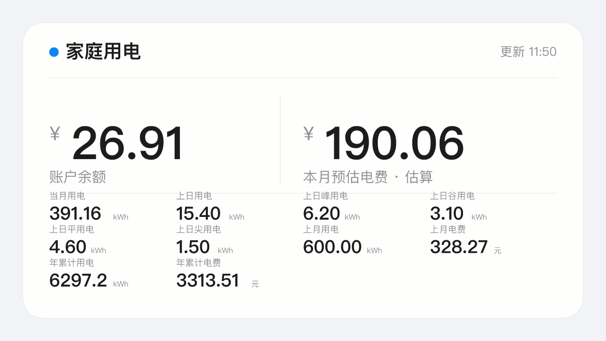
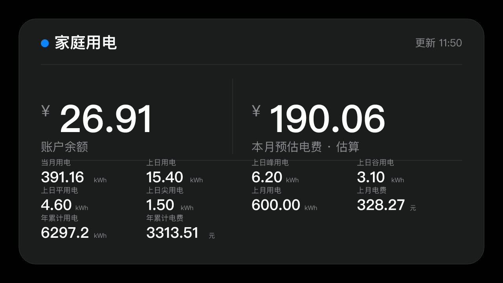
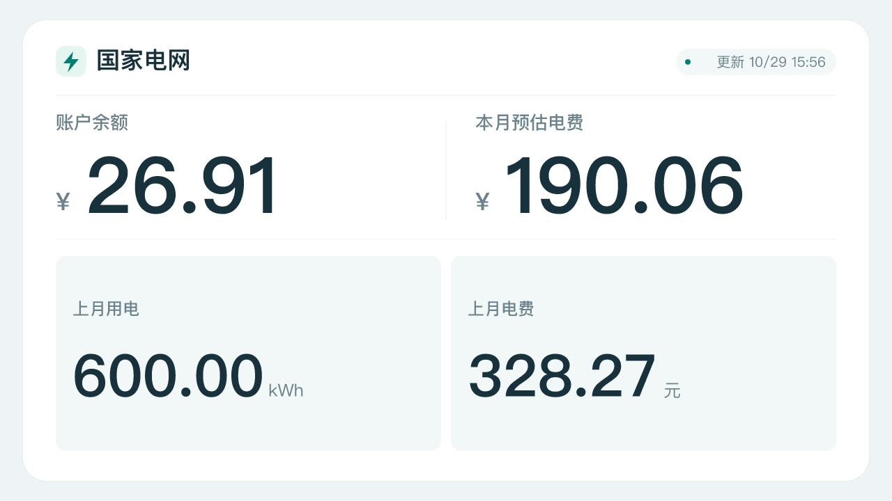
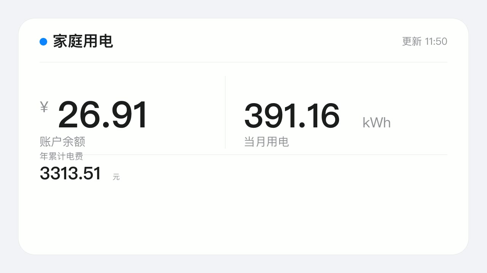
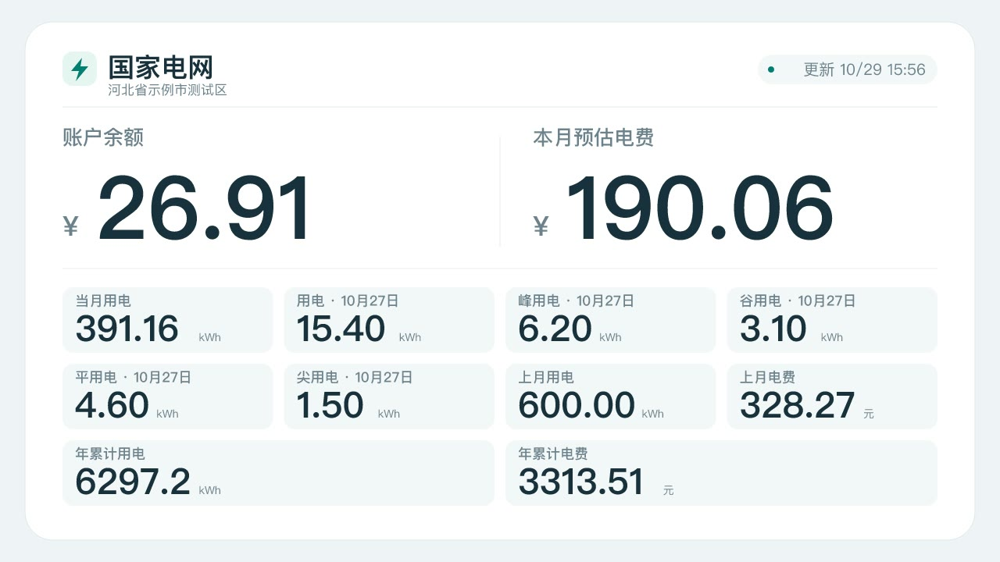

# homebridge-state-grid

当前版本：**0.10.0**。

把「网上国网」的用电数据做成 **HomeKit 虚拟摄像头**，在 Apple「家庭」App 首页直接看到一张用电卡片。



不需要 Home Assistant、不需要 Python、不需要 Docker——纯 Node 进程，跟着 Homebridge 一起跑。

---

## 它长什么样

每个户号对应一路摄像头，默认名称为“国家电网”，多个户号可分别自定义名称。卡片顶部地区默认隐藏，可按户号开启。主数字为「账户余额/应交电费」，右侧并列「当月累计电费估算」，其余指标在下方自适应排版，删除指标后自动调整列数、占位与字号，末行铺满，顶部两项始终最大。插件内置 26 个数值指标及近12个月趋势图：账户余额、当月累计电费估算、当月用电、上日用电、上日峰/谷/平/尖用电、当月峰/谷/平/尖用电、上月用电、上月电费、年累计用电、年累计电费、当前阶梯、违约金、历史欠费。显示哪些指标、按什么顺序，全都在设置页的「卡片指标」标签页里图形化配置（勾选显隐 + 上下排序），保存后几秒内自动生效，无需重启。数据每 6～24 小时刷新一次，卡片上的时间戳是最近一次成功查询的时间；日用电另标数据日期。接口只有部分日期且没有累计总量时，月用电明确标注“部分”。

| 浅色 | 深色 |
| --- | --- |
|  |  |

卡片固定使用「上月用电」「上月电费」标签；接口返回的实际账单月份仍保留在数据中。浅色与深色主题使用统一圆角、留白和数字层级。

| 只保留 4 项 | 保留 3 项 |
| --- | --- |
|  |  |

数据取不到时，卡片显示 `—` 和「数据未更新」，**不把缺失值补成 0**；接口返回的真实零值会正常显示。

---

## 历史账单、同比与趋势

设置页新增 **用电统计**：打开时只读取本机缓存，完成登录后的正常数据刷新会查询历史账单。

- **结算月电量／电费同比**：最近已结算月与上一年同月对比，明确显示两个月份及本期、同期值。
- **同月份累计电量**：严格比较今年与去年 1 月至最近已结算月份；某一年缺月时，该年的累计值显示 `—`，不把缺月补成零。
- **同日区间电量同比**：例如本期 11月1—3日与上年 11月1—3日。需要两边相同区间的完整数据，不用去年整月账单代替；闰日不匹配或接口不返回时显示 `—`。
- **近12个结算月趋势**：以最新结算月为结束月份，支持切换用电量与结算电费；缺失月份留空，真实零正常显示，不混入当月未结算的累计值。

同比公式为 `(本期 − 上年同期) ÷ 上年同期 × 100%`，正数带 `+`。上年基期为零时不输出百分比，仍保留原值和差额。各省、户号返回历史范围可能不同；本次已在 15.100 的有效会话验证 2025年12个月账单及去年11月1—3日逐日电量。

历史年度账单与相同逐日区间缓存 24 小时；截止日变化会重新查询，记录随当前快照持久化。历史接口业务／网络失败时保留已有历史并标注，不把当前用电量改成零；认证问题沿用原有登录恢复机制。

在 **卡片指标** 中可勾选同比、同期累计与 **近12个结算月趋势图**，原有指标顺序继续使用；趋势图固定在数值区域下方，顶部两个数字保持最大。统计页始终可查看完整对比。大号 iOS 小组件在启用趋势图后显示前4个数值及图表；无图表且有多条说明时显示前6项，其余情况最多8项，避免挤出组件边界。

---

## 累计电费估算口径

**累计电费估算 = 数据截至日的当月累计电量 ×（最近已结算月电费 ÷ 同月结算电量）**。它是已用电量按历史均价折算的金额，未外推月底，也不替代国网实际账单或阶梯/峰谷电价计算。

- 当前月份显示「当月累计电费估算」，跨月缓存改为实际月份，例如「10月累计电费估算」；跨年时带年份。用电量标签同步使用实际月份。
- 卡片注明数据截至日、参考账单月份和平均单价。例如 `截至11-03 · 参考10月均价0.7571元/度`；更新时间表示查询成功时间，与电量截至日分开。
- 只有电量覆盖完整、日期明确且参考账单有效时才显示金额。缺日、覆盖范围不明、数据无效或缺少有效账单时显示 `—` 并解释原因；真实零值保留。
- 设置页、家庭卡片和 iOS 小组件共用相同口径。跨月时会重绘本地缓存，无需为修改标签重新登录国网。
- 升级后请重新复制「国家电网.js」覆盖手机 Scriptable 中的原脚本，以显示小组件的截至日说明和离线跨月标签；保留原脚本名称即可继续使用已有档案和令牌。

---

## iOS 桌面小组件

从 0.9.0 起，可将用电数据放在 iPhone 桌面。手机安装 [Scriptable](https://scriptable.app/)，无需独立开发者签名。

1. 打开插件设置 → **iOS 小组件**，勾选启用接口，默认端口 `19861`，点击 **应用小组件设置**；主进程几秒内生效，关闭设置页仍可读取。
2. 点击 **生成令牌**，再点 **复制令牌**。已有令牌时通过 **重置令牌 → 确认重置令牌** 重新生成。令牌只显示一次，服务器仅保存哈希；再次生成会使旧令牌立即失效。
3. 下载页面中的 **国家电网.js**，保存到 Scriptable 并运行。也可点击 **复制脚本内容**，新建脚本并粘贴；自动复制受限时使用 **查看 / 手动复制脚本 → 全选脚本**，电脑按 Ctrl+C / ⌘C，手机长按选择“拷贝”。脚本源文件在 [homebridge-ui/public/widgets/国家电网.js](homebridge-ui/public/widgets/国家电网.js)。
4. 选择 **新增或重新配置**，填写档案名（例如“默认”）、服务器地址（例如 `http://Homebridge主机IP:19861`）和令牌，再选择户号。令牌保存在手机钥匙串，脚本中不嵌入凭据。
5. 在 iPhone 桌面添加 Scriptable 小组件，选择“国家电网”脚本。Parameter 留空读取“默认”档案；多个服务器/户号可分别建立档案，并在不同小组件的 Parameter 中填写对应档案名。

| 尺寸 | 展示内容 |
| --- | --- |
| 小 | 前 2 个已保存指标 |
| 中 | 前 4 个已保存指标 |
| 大 | 最多8项；含多条说明时6项，启用趋势图时4项＋图表 |

名称、配色、指标顺序沿用已保存的卡片配置；顶部两个数字最大。缺失数据展示 `—`，真实零正常显示。联网失败时保留手机本地缓存和原始更新时间；接口返回令牌失效或户号已停用后，清除对应手机缓存。小组件请求每小时刷新，但实际时机由 iOS 决定；数据仍按插件已有的 6～24 小时周期更新，小组件不会触发重复登录或额外查询国网。

手机必须能访问 Homebridge 主机。HTTP 接口监听主机 IPv4 网卡，适用于可信局域网，外出使用 VPN；不要直接映射公网。需要 HTTPS 时，可自行通过反向代理提供独立域名（`/v1/widget` 路径不变），脚本不会携带令牌跟随重定向。iOS 首次提示局域网权限时应允许 Scriptable 访问。

接口为 `GET /v1/widget`，通过 `Authorization: Bearer <令牌>` 认证，不接受 URL 令牌，不允许写入操作。仅返回已启用户号的匿名卡片 ID、显示名、可选粗略地区、指标和更新时间，不返回原始户号、户名、详细地址、手机号或国网登录会话。多个手机可共享令牌；**撤销令牌**使所有使用该令牌的手机失去新数据访问权限。接口和令牌设置立即生效，独立于下方的卡片配置保存。

---

## 为什么是摄像头

| 方案 | 问题 |
| --- | --- |
| 温度/湿度传感器 | 只能表达一个数，HomeKit 没有"多指标"配件 |
| 自定义服务（Matter） | 家庭 App 里不渲染自定义字段 |
| **摄像头** | 快照即缩略图、点开即全屏，是最稳的"任意画面"载体 |

视频由 ffmpeg 根据 HomeKit 协商的地址、分辨率、码率和 payload type 输出 H.264/SRTP，并按实际时间限速。每个视频会话独立管理；无需外部媒体服务器。`src/camera/srtp.ts` 保留标准向量与独立互通验证使用的算法。

---

## 安装

```bash
npm install -g https://github.com/roninriddle/homebridge-state-grid/releases/download/v0.10.0/homebridge-state-grid-0.10.0.tgz
```

当前正式包通过本项目 GitHub Release 分发。安装 0.8.0 后，可在插件设置页自动检查后续版本并选择安装。

要求：**Node ≥ 22**（用到原生 `sm4-ecb` / `sm3`）、Homebridge ≥ 1.8。

---

## 配置

| 字段 | 说明 | 默认 |
| --- | --- | --- |
| `username` | 网上国网手机号 | — |
| `password` | 登录密码（也只在首次登录时用，之后以设置页保存的为准） | — |
| `updateIntervalHours` | 刷新周期，范围 6～24 | `12` |
| `showRegion` | 卡片顶部是否显示省市区；支持按户号覆盖 | `false` |
| `theme` | 卡片主题 `light` / `dark` | `light` |
| `snapshotWidth` / `snapshotHeight` | 快照尺寸 | `1280` / `720` |
| `fields[]` | 卡片指标顺序（可选，作为回退默认；日常在设置页「卡片指标」标签页里图形化配置） | 12 项默认 |
| `accounts[]` | 户号级配置：`consNo`、`title`（摄像头名称）、`showRegion`、`enabled` | 全部启用 |

`consNo` 填接口返回的**原始户号**（`consNoSrc`）。在设置页「户号与卡片预览」标签页里能看到每个户号及其卡片预览，照抄即可。

`fields` 是一个**有序数组**，顺序即显示顺序：第 1 项是卡片主数字，第 2 项与它并列，其余进入下方自适应网格。日常不需要手写——设置页「卡片指标」标签页里是图形化的勾选+排序界面（共 26 个数值指标及趋势图，默认显示 12 个）。

---

## 插件更新

0.8.0 起可在 **连接与登录 → 插件更新** 查看已安装版本、最新正式版本、上次检查时间与发布说明。主进程默认每 12 小时检查一次 GitHub Release，设置页关闭或网上国网需要验证时也能检查；可关闭自动检查，或点击“立即检查”手动查询。检查只向本项目的 GitHub 发布接口发送插件版本，不发送手机号、户号、设备种子或登录令牌。

发现新版本后点击 **安装版本号**。安装器会校验 GitHub 资产的 SHA-256，在暂存目录安装锁定依赖，并检查 Node.js、Homebridge、原生渲染与 JPEG 转码。通过后替换插件目录并保留原插件备份；配置、登录态、设备身份和户号开关保留。安装完成后到插件页重启“国家电网”子网桥，再重新打开设置页。自动检查不会自动安装，也不会自动重启。

检查失败或 GitHub 限流时保留上次结果并退避重试，不影响用电卡片。安装准备失败时保留正式插件；激活目录替换失败时立即恢复旧目录。目录不可写、开发链接安装或 Windows 环境可查看发布页，并使用 Homebridge 插件管理器处理安装。

正式版本由 Git 标签触发 `.github/workflows/release.yml`：校验版本号、运行测试及视频专项、生成含 `dist/` 与依赖锁文件的 `.tgz` 和 `SHA256SUMS`，上传成功后公开 Release。预览版不会进入更新提示。尚未上传完整校验资产的版本只显示发布说明，不能安装。

---

## 首次登录

首次在新设备登录时，国家电网会要求短信验证。插件不做静默绕过，只把这一步交给设置页：

1. 插件设置页 → 填手机号 → **密码登录**，或点 **短信验证码登录**（无需密码）
2. 若返回 `4006`（新设备校验）→ **发送验证码** → 填入 6 位码 → **提交**
3. 登录成功后切到 **户号与卡片预览** 标签页查看户号与卡片；每个户号右上角有**启用开关**，关闭后主进程会在几秒内把该摄像头从「家庭」App 移除，无需重启
4. 保存设置 → 重启 Homebridge → 在「家庭」App 里添加 Homebridge

> 密码登录被拒绝可能涉及网关、限流或账号安全校验，不能仅凭 RK007 判定密码问题。可在设置页尝试短信登录；设备验证和额外安全挑战仍需按服务端要求完成。

停用户号的预览也会按当前保存的指标和名称重绘本地缓存，不沿用停用前的旧图片。

户号列表与预览选择器显示接口提供的户名、**完整户号**、用电地址和启用状态，便于区分多个账户；这些身份信息只在 Homebridge 设置页展示，家庭 App 摄像头继续使用独立的默认或自定义名称。上游若已脱敏，设置页按接口原样展示。

设置页分三个标签页：**连接与登录**、**户号与卡片预览**、**卡片指标**。「户号与卡片预览」打开时默认读插件最近一次刷新落盘的缓存（户号列表、指标摘要、卡片预览图），**不重新联网**，因此不会反复触发国网的风控；只有点「刷新」按钮才向国网拉取最新数据。「卡片指标」里勾选并排序要显示的指标，右侧约 250ms 防抖实时预览。预览支持摄像头名称、地区显隐和指标顺序，只读本地缓存，不登录、不请求国网、不改正式配置；无缓存时明确标注模拟数据。切换标签页保留草稿，“保存卡片”和窗口底部“保存”都提交同一份卡片设置，包含指标顺序、名称与地区显示；关闭再打开也保持一致。主进程每 8 秒检查并应用保存的卡片设置。名称与地区区域内的保存按钮也会保存当前卡片更改。预览主题仅用于查看效果，正式主题沿用插件配置。

登录态（token）与设备种子写在 `storage/state-grid/` 下，重启后沿用，不会重复要验证码。

> ⚠️ **不要手工删 `device.json`**。里面是设备指纹的种子，删了服务端就会认为换了一台手机，下一次登录又要短信验证。

---

## 工作原理

```
登录/查询  →  src/sgcc/     国密信封 + Turing V90 设备指纹（由上游 Python 逐字节翻译）
渲染      →  src/renderer/  SVG 排版 → resvg 栅格化成 PNG → ffmpeg 转 JPEG
出画面    →  src/camera/    ffmpeg 按协商参数、实际时间输出 H.264/SRTP
状态落地  →  src/services/  storage 目录：设备种子、会话、户号、卡片缓存
```

三处值得单独说明：

**1. 设备指纹必须稳定。** 32 字节种子经 HMAC-SHA256 派生机型、版本、传感器、性能上下文等全部设备特征；同一台机器上每次启动都必须得到同一份指纹，否则服务端判定为新设备。所以种子落盘、token 缓存 4 小时（对应 App 行为）。

**2. 协议正确性靠跨语言对拍。** `tools/gen-golden.py` 直接调用上游 Python 生成期望值，`tests/golden.test.ts` 逐字节比对 TS 实现——测试中有 17 项是这种黄金向量，涵盖 SM4/SM3/SM2 信封、64 位哈希、JCE 序列化、XXTEA、mode-0/1 token。

**3. 少一个原生依赖就少一半安装故障。** SVG 栅格化选 resvg（预编译二进制）而不是 node-canvas（cairo/pango）；PNG→JPEG 复用已有的 ffmpeg 而不是再引一个 JS 编码器。装不上的插件等于没写。

---

## 几条硬约定

- **缺失不补 0**：接口没返回就是 `undefined`，卡片渲染成 `—`。
- **估算必须标注**：本月电费用「上月实际均价 × 本月电量」反推，统一标为「当月累计电费估算」，不重复追加「估算」，不冒充账单。
- **周期 6～24 小时**：接口不欢迎高频轮询，也不值得。
- **过期要说**：超过 26 小时没成功刷新，卡片标注「数据未更新 · 最近成功 …」。
- **保存的密码做明文遮蔽**：AES-256-GCM，沿用主机名、用户名和固定盐派生密钥以兼容旧安装。它不抵御已知主机信息的离线恢复；应保护 storage、config.json 和备份的访问权限。在 Homebridge 原始配置中填写的密码仍受其配置存储规则管理。

---

## 摄像头名称、地区显示与余额

- **默认名称是“国家电网”**，不使用户号、手机号或地区作为默认名称。多个户号可分别起名，如“自家用电”“父母家用电”。
- 设置页 → **卡片指标** → 选择户号 → 编辑“摄像头名称”，勾选或取消“显示卡片顶部的省市区” → **保存名称与地区显示**。草稿即时预览，保存后几秒内同步到摄像头和卡片，无需重启。
- **地区默认隐藏**。开启后，在名称下方单独显示省市区，过滤街道、门牌和脱敏星号；名称本身不会随地区开关改变。
- 也可用 `accounts[].title`、全局或单户号的 `showRegion` 配置默认值；设置页保存的户号设置优先。原配件 UUID 保持不变，无需重新配对。


- 明确返回预付费类型（`consType=1`）时，零余额和负余额也保留为「账户余额」；其他响应有预存余额时使用对应余额字段。各省字段仍需对照真实 App 校准，缺失值不会补零。

---

## 已知限制

- **省份差异**：日用电日期支持 `YYYYMMDD` 和 `YYYY-MM-DD`；月账单支持 `monthPq/monthAmt` 和嵌套 `eleList`；年度累计优先读取 `yearPq/yearAmt`。其他省份需逐项对照 App。默认日志不输出原始账户响应。
- **电费只是估算**：阶梯电价、峰谷、代扣优惠都没算。
- **户号多时首刷线性变慢**：每个户号要串行查日用电、余额、月账单。
- **登录风控**：复用设备种子和服务器会话，token 明确失效时最多自动重登一次；4006/RK008 进入人工验证。旧版猜测的 30 分钟有效期迁移为未知，下一次正常业务请求向服务端验证，不人为延长服务器 token 有效期。
- **字体**：macOS 使用系统中文字体；Linux 建议安装 Noto Sans CJK SC。resvg 不附带中文字体。
- **HomeKit 实机验收**：回环 SRTP 解码测试不能替代家庭 App 的首页、全屏、双客户端和远程访问验收。

---

## 开发

```bash
npm install
npm run build      # tsc，含类型检查
npm test           # 编译 + 黄金向量 / 会话 / 缓存 / 设置页 / 渲染回归
npm run test:stream # 回环双会话、独立 SRTP 解密与 ffmpeg 解码（需 ffmpeg）
npm run probe      # 设置页链路自测（不联网、不需要 Homebridge）
npm run demo       # 生成 preview/*.jpg 样张
```

如果 `tsc` 在受限环境里跑不起来（某些沙箱会拒绝它的大量文件探测），可以退一步只做转译：

```bash
node tools/build-esbuild.mjs
```

它不做类型检查，产出的模块形态与 tsc 一致，可以互相覆盖——**发版前仍然必须跑一次 `npm run build`**。

目录：

```
src/sgcc/        协议层（不依赖 Homebridge，可独立测试）
src/renderer/    SVG 卡片与栅格化
src/camera/      SRTP / RTP / 摄像头配件
src/services/    持久化与设备档案装配
src/platform.ts  Homebridge 平台（唯一接触 HomeKit 的地方）
homebridge-ui/   设置页（独立进程，经原子写的 storage 文件与主进程通信）
reference/       上游对照资料（不参与运行）
```

---

## 许可

MIT。协议实现翻译自 [stevenjoezhang/hass-state-grid](https://github.com/stevenjoezhang/hass-state-grid)（MIT），
详见 [LICENSE](LICENSE) 中的上游声明。

本项目与「网上国网」、国家电网有限公司无任何关联。请遵守相关服务条款，仅限个人、非商业用途。
