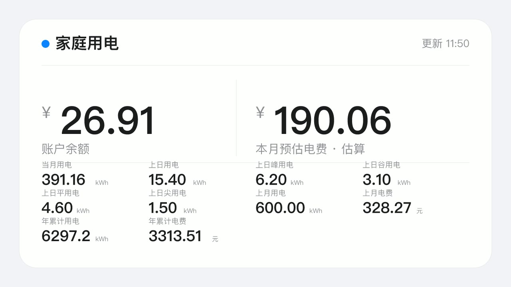
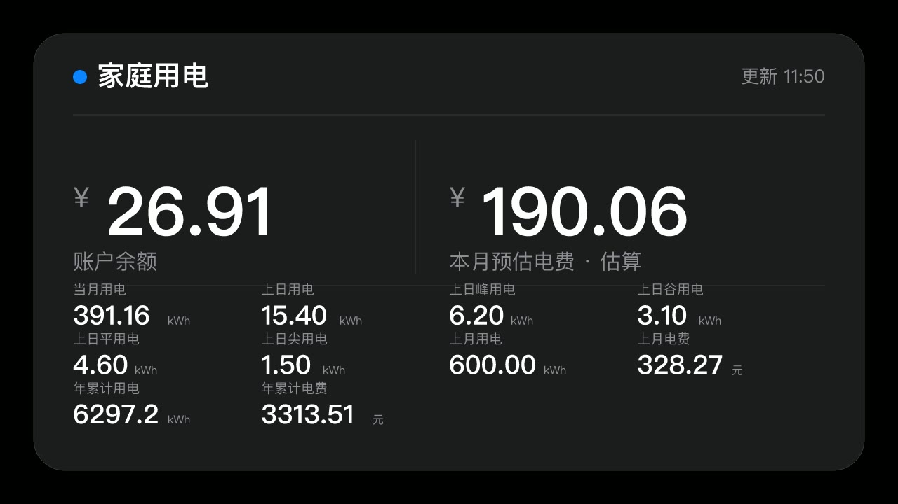

# homebridge-state-grid

把「网上国网」的用电数据做成 **HomeKit 虚拟摄像头**，在 Apple「家庭」App 首页直接看到一张用电卡片。



不需要 Home Assistant、不需要 Python、不需要 Docker——纯 Node 进程，跟着 Homebridge 一起跑。

---

## 它长什么样

每个户号对应一路摄像头，卡片顶部是「账户余额/应交电费」主数字，右侧并列「本月预估电费」，下方 4 列网格展示其余指标。插件内置 19 个指标：账户余额、本月预估电费、当月用电、上日用电、上日峰/谷/平/尖用电、当月峰/谷/平/尖用电、上月用电、上月电费、年累计用电、年累计电费、当前阶梯、违约金、历史欠费。显示哪些指标、按什么顺序，全都在设置页的「卡片指标」标签页里图形化配置（勾选显隐 + 上下排序），保存后几秒内自动生效，无需重启。数据每 6～24 小时刷新一次，卡片上的时间戳就是最近一次成功的时间。

| 浅色 | 深色 |
| --- | --- |
|  |  |

数据取不到时，卡片显示 `—` 和「数据未更新」，**绝不显示 0**——0 会被误读成"这个月没用电"。

---

## 为什么是摄像头

| 方案 | 问题 |
| --- | --- |
| 温度/湿度传感器 | 只能表达一个数，HomeKit 没有"多指标"配件 |
| 自定义服务（Matter） | 家庭 App 里不渲染自定义字段 |
| **摄像头** | 快照即缩略图、点开即全屏，是最稳的"任意画面"载体 |

代价是要实现 SRTP + H.264 打包，这部分在 `src/camera/` 里，已按 RFC 3711 手写，不依赖外部媒体服务器。

---

## 安装

```bash
npm install -g homebridge-state-grid
```

或在 Homebridge UI 的「插件」页搜索 `homebridge-state-grid`。

要求：**Node ≥ 22**（用到原生 `sm4-ecb` / `sm3`）、Homebridge ≥ 1.8。

---

## 配置

| 字段 | 说明 | 默认 |
| --- | --- | --- |
| `username` | 网上国网手机号 | — |
| `password` | 登录密码（也只在首次登录时用，之后以设置页保存的为准） | — |
| `updateIntervalHours` | 刷新周期，范围 6～24 | `12` |
| `theme` | 卡片主题 `light` / `dark` | `light` |
| `snapshotWidth` / `snapshotHeight` | 快照尺寸 | `1280` / `720` |
| `fields[]` | 卡片指标顺序（可选，作为回退默认；日常在设置页「卡片指标」标签页里图形化配置） | 12 项默认 |
| `accounts[]` | 户号级配置：`consNo`、`title`、`enabled` | 全部启用 |

`consNo` 填接口返回的**原始户号**（`consNoSrc`）。在设置页「户号与卡片预览」标签页里能看到每个户号及其卡片预览，照抄即可。

`fields` 是一个**有序数组**，顺序即显示顺序：第 1 项是卡片主数字，第 2 项与它并列，其余进入下方 4 列网格。日常不需要手写——设置页「卡片指标」标签页里是图形化的勾选+排序界面（共 19 个指标，默认显示 12 个）。

---

## 首次登录

首次在新设备登录时，国家电网会要求短信验证。插件不做静默绕过，只把这一步交给设置页：

1. 插件设置页 → 填手机号 → **密码登录**，或点 **短信验证码登录**（无需密码）
2. 若返回 `4006`（新设备校验）→ **发送验证码** → 填入 6 位码 → **提交**
3. 登录成功后切到 **户号与卡片预览** 标签页查看户号与卡片；每个户号右上角有**启用开关**，关闭后主进程会在几秒内把该摄像头从「家庭」App 移除，无需重启
4. 保存设置 → 重启 Homebridge → 在「家庭」App 里添加 Homebridge

> 💡 密码登录若报 `RK007 网络连接超时`，多半是密码过于简单被风控拒绝，改用**短信验证码登录**即可绕过，或到 App 里把密码改成复杂密码。

设置页分三个标签页：**连接与登录**、**户号与卡片预览**、**卡片指标**。「户号与卡片预览」打开时默认读插件最近一次刷新落盘的缓存（户号列表、指标摘要、卡片预览图），**不重新联网**，因此不会反复触发国网的风控；只有点「刷新」按钮才向国网拉取最新数据。「卡片指标」里勾选并排序要显示的指标，保存后主进程自动重新渲染卡片。

登录态（token）与设备种子写在 `storage/state-grid/` 下，重启后沿用，不会重复要验证码。

> ⚠️ **不要手工删 `device.json`**。里面是设备指纹的种子，删了服务端就会认为换了一台手机，下一次登录又要短信验证。

---

## 工作原理

```
登录/查询  →  src/sgcc/     国密信封 + Turing V90 设备指纹（由上游 Python 逐字节翻译）
渲染      →  src/renderer/  SVG 排版 → resvg 栅格化成 PNG → ffmpeg 转 JPEG
出画面    →  src/camera/    循环编码 PNG 成 H.264 → RTP 打包 → SRTP 加密 → UDP
状态落地  →  src/services/  storage 目录：设备种子、会话、户号、卡片缓存
```

三处值得单独说明：

**1. 设备指纹必须稳定。** 32 字节种子经 HMAC-SHA256 派生机型、版本、传感器、性能上下文等全部设备特征；同一台机器上每次启动都必须得到同一份指纹，否则服务端判定为新设备。所以种子落盘、token 缓存 4 小时（对应 App 行为）。

**2. 协议正确性靠跨语言对拍。** `tools/gen-golden.py` 直接调用上游 Python 生成期望值，`tests/golden.test.ts` 逐字节比对 TS 实现——46 项测试里有 17 项是这种黄金向量，涵盖 SM4/SM3/SM2 信封、64 位哈希、JCE 序列化、XXTEA、mode-0/1 token。

**3. 少一个原生依赖就少一半安装故障。** SVG 栅格化选 resvg（预编译二进制）而不是 node-canvas（cairo/pango）；PNG→JPEG 复用已有的 ffmpeg 而不是再引一个 JS 编码器。装不上的插件等于没写。

---

## 几条硬约定

- **缺失不补 0**：接口没返回就是 `undefined`，卡片渲染成 `—`。
- **估算必须标注**：本月电费用「上月实际均价 × 本月电量」反推，卡片上写「估算」，不冒充账单。
- **周期 6～24 小时**：接口不欢迎高频轮询，也不值得。
- **过期要说**：超过 26 小时没成功刷新，卡片标注「数据未更新 · 最近成功 …」。
- **密码不落明文**：AES-256-GCM，密钥由「主机名 + 用户名 + 插件固定盐」派生。不是硬件级保护（同机同用户可解），但能挡住备份泄露、日志误传、配置文件外发。

---

## 户号名称与余额显示

- **户号标题只显示地区**（如「北京市通州区」「石家庄市裕华区」），取自地址字段并去掉脱敏星号，不暴露真实姓名。可在 `accounts[].title` 里自定义。
- **预付费户号**（`prepayBal > 0`）主数字显示「账户余额」；**后付费户号**（`prepayBal = 0`）主数字显示「应交电费」。这是国网接口按户号类型返回的差异，不是解析错误。

---

## 已知限制

- **协议字段以真实账号校准**：已用真实账号验证（预付费与后付费各一），日用电日期为 `YYYYMMDD`、月账单字段为 `monthPq/monthAmt`、余额字段为 `prepayBal/sumMoney`。若你的省份接口字段有差异，日志会打印原始响应便于定位。
- **电费只是估算**：阶梯电价、峰谷、代扣优惠都没算。
- **户号多时首刷线性变慢**：每个户号要串行查日用电、余额、月账单。
- **国网有每日登录次数限制**：频繁重启/重登可能触发风控（RK007 等），建议密码设置为「大小写+数字+符号」的复杂密码，或用短信验证码登录。

---

## 开发

```bash
npm install
npm run build      # tsc，含类型检查
npm test           # 46 项：黄金向量 / 设备档案 / 摄像头 / 渲染 / DEFLATE
npm run probe      # 设置页链路自测（不联网、不需要 Homebridge）
npm run demo       # 生成 preview/*.jpg 样张
```

如果 `tsc` 在受限环境里跑不起来（某些沙箱会拒绝它的大量文件探测），可以退一步只做转译：

```bash
node tools/build-esbuild.mjs
```

它不做类型检查，产出的模块形态与 tsc 一致，可以互相覆盖——**发版前仍然必须跑一次 `npm run build`**。

目录：

```
src/sgcc/        协议层（不依赖 Homebridge，可独立测试）
src/renderer/    SVG 卡片与栅格化
src/camera/      SRTP / RTP / 摄像头配件
src/services/    持久化与设备档案装配
src/platform.ts  Homebridge 平台（唯一接触 HomeKit 的地方）
homebridge-ui/   设置页（独立进程，只经 storage 目录与主进程通信）
reference/       上游对照资料（不参与运行）
```

---

## 许可

MIT。协议实现翻译自 [stevenjoezhang/hass-state-grid](https://github.com/stevenjoezhang/hass-state-grid)（MIT），
详见 [LICENSE](LICENSE) 中的上游声明。

本项目与「网上国网」、国家电网有限公司无任何关联。请遵守相关服务条款，仅限个人、非商业用途。
